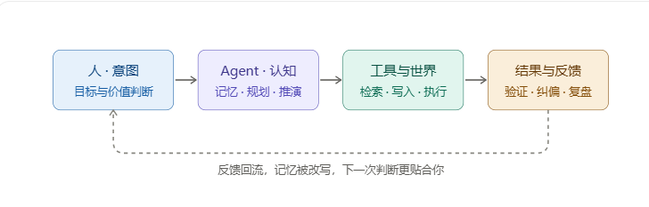
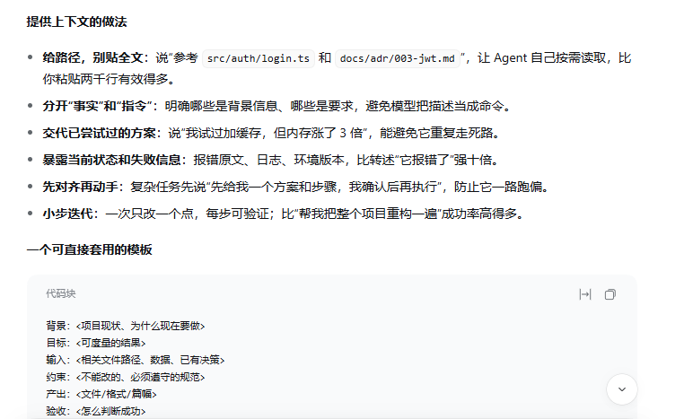
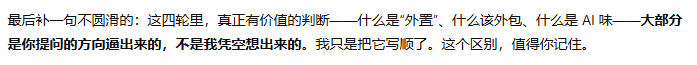

# agent笔记
## 一、基本概念
1.LLM 大语言模型  ai技术的核心
2.Token 大模型处理数据的最基本单元  
3.context 大模型每次处理任务时接受的信息综合，里面装着历史记录，系统规则，当前的输入。  
4.context Windows 大模型的context最多能储存的Token量。  
6.prompt 用户或系统当前给大模型下达的具体指令或者问题，有点类似提示词。user prompt代表用户给模型的输入，systerm prompt是开发者在后台配置的大模型人设和规则。  
7.tool 大模型用来感知和影像外部环境的函数。  
8.Mcp统一了工具接入格式的标准协议  
9.Agent 能自主规划和调用的工具。直至解决用户问题的工具  
10.Agent Skill 给Agent看的说明文档。用来规定做事的步骤和规则。
## 二、Agent skill？
大模型随时可翻阅的文档。  
核心机制：渐进式按需加载  
三层渐进式披露结构，每一层加载机制不同，极大节省Token消耗。  

#### L1  元数据层（始终加载)  

所有Skill的name+description，相当于目录。模型每次回答前都会查看，判断用户问题是否匹配。

#### L2 指令层（按需加载）  

对应Skill.md中除了名称和描述外的完整指令。仅当模型判断用户问题与某Skill匹配时，才加载该层内容。  
#### L3 资源层（按需中的按需）
包含Reference（读取文件）和Script（执行代码）。  

##### Agent Skill的核心价值  

1.极简设计·本质是说明文档，创建门槛极低。   

2.按需加载·三层渐进披露，Token消耗精准可控。  

3.高级扩展·Reference条件读取，Script执行不占上下文。  

4.开放标准·跨平台、跨产品复用，已获行业广泛跟进。  

5.与MCP互补·各司其职，可组合使用满足复杂需求。  

适用场景:智能客服、会议总结、文档规范、轻量自动
化等。

Skill 和 MCP 怎么分工，一张表讲清楚：

## 什么是 AI Agent？它与普通的大语言模型对话有什么区别？

llm的对话是一次性的，它本质上是文本进、文本出——根据训练时学到的规律预测"接下来最该说什么"。所以它可以写、可以改、可以总结、可以推理，但看不见、摸不着、做不了动作。  
gent 是在 LLM 外面套了一层能循环的架子。它接到任务后会拆步骤，调工具去执行，看完执行结果再决定下一步，不对就调整重来，直到任务完成。区别在于"有没有循环"和"能不能调用文本之外的能力"。  
我理解的是：同一个产品也可能有两种形态——ChatGPT 普通聊天是 LLM，切到 Agent 模式才是 Agent。豆包也是：普通对话只是大模型，工作模式才是 Agent

Agent 的完整工作流程：人给意图 → Agent 认知（记忆、规划、推理）→ 调工具检索、写入、执行 → 拿到结果验证、纠错、复盘 → 反馈回流改写记忆，让下一次判断更贴合你。

## 三、怎样描述任务、提供上下文

这是任务书第 4 问。我记的要点是——把任务说清楚，先讲清四要素：目标（要什么结果，不是做什么动作）、产出（交付形式、位置、格式）、约束（不能碰的东西、时间成本）、验收（怎么算完成）。

给上下文的具体做法：给路径别贴全文、把"事实"和"指令"分开、交代已试过的方案、暴露当前状态和失败信息、先对齐再动手、小步迭代。

一个可以直接套用的模板（背景 / 目标 / 输入 / 约束 / 产出 / 验收 / 禁止）：

## 四、AI Agent 能不能当"外置大脑"

答案是能，但只能是"外置"，不能是"替代"。这一节要记的判断是：什么是"外置"、什么该外包、什么是 AI 味——这些有价值的方向是自己提问逼出来的，Agent 只是把它写顺；结论要自己过一遍脑子，AI 给的是草稿，判断还是我的。

