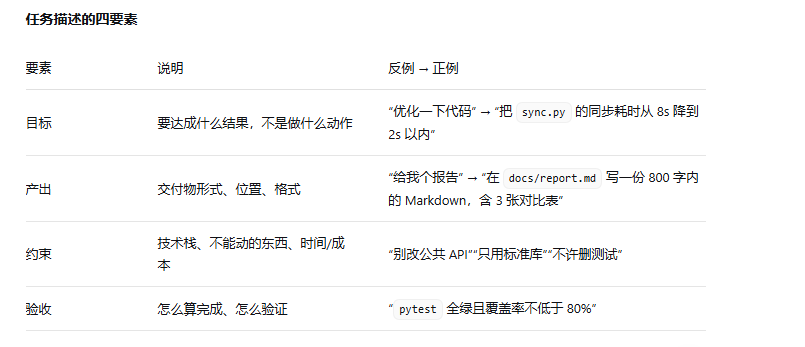
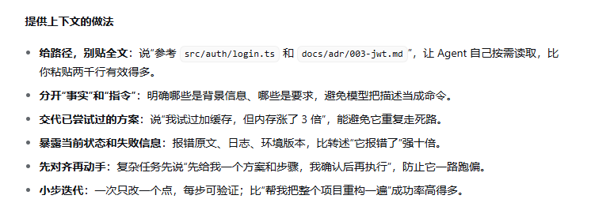
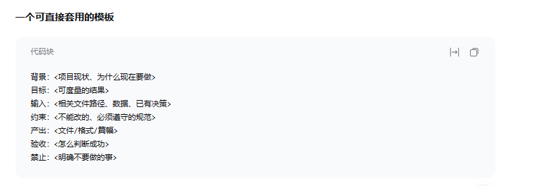
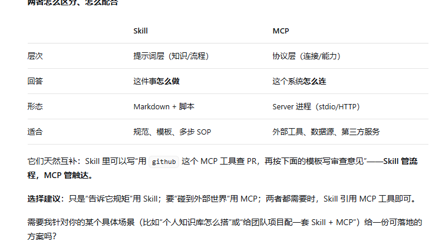

# agent笔记
## 一、基本概念
1.LLM 大语言模型  ai技术的核心
2.Token 大模型处理数据的最基本单元  
3.context 大模型每次处理任务时接受的信息综合，里面装着历史记录，系统规则，当前的输入。  
4.context Windows 大模型的context最多能储存的Token量。  
6.prompt 用户或系统当前给大模型下达的具体指令或者问题，有点类似提示词。user prompt代表用户给模型的输入，systerm prompt是开发者在后台配置的大模型人设和规则。  
7.tool 大模型用来感知和影像外部环境的函数。  
8.Mcp统一了工具接入格式的标准协议  
9.Agent 能自主规划和调用的工具。直至解决用户问题的工具  
10.Agent Skill 给Agent看的说明文档。用来规定做事的步骤和规则。
## 二、Agent skill？
大模型随时可翻阅的文档。  
核心机制：渐进式按需加载  
三层渐进式披露结构，每一层加载机制不同，极大节省Token消耗。  

#### L1  元数据层（始终加载)  

所有Skill的name+description，相当于目录。模型每次回答前都会查看，判断用户问题是否匹配。

#### L2 指令层（按需加载）  

对应Skill.md中除了名称和描述外的完整指令。仅当模型判断用户问题与某Skill匹配时，才加载该层内容。  
#### L3 资源层（按需中的按需）
包含Reference（读取文件）和Script（执行代码）。  

##### Agent Skill的核心价值  

1.极简设计·本质是说明文档，创建门槛极低。   

2.按需加载·三层渐进披露，Token消耗精准可控。  

3.高级扩展·Reference条件读取，Script执行不占上下文。  

4.开放标准·跨平台、跨产品复用，已获行业广泛跟进。  

5.与MCP互补·各司其职，可组合使用满足复杂需求。  

适用场景:智能客服、会议总结、文档规范、轻量自动
化等。

## 什么是 AI Agent？它与普通的大语言模型对话有什么区别？

llm的对话是一次性的，它本质上是文本进、文本出——根据训练时学到的规律预测"接下来最该说什么"。所以它可以写、可以改、可以总结、可以推理，但看不见、摸不着、做不了动作。  
gent 是在 LLM 外面套了一层能循环的架子。它接到任务后会拆步骤，调工具去执行，看完执行结果再决定下一步，不对就调整重来，直到任务完成。区别在于"有没有循环"和"能不能调用文本之外的能力"。  
我理解的是：同一个产品也可能有两种形态——ChatGPT 普通聊天是 LLM，切到 Agent 模式才是 Agent。豆包也是：普通对话只是大模型，工作模式才是 Agent  

## 2. 除了底层 LLM，一个 Agent 系统通常还包含哪些部分？  
 1.运行时与循环（Agent Loop）

调度“模型思考 → 调用工具 → 观察结果 → 再思考”的循环，并决定何时停止。
并发与异步：多个工具调用、后台任务、超时与取消。
错误处理：重试、降级、循环检测（防止反复调用同一个工具）。
2. 工具层（Tool / Action Layer）

工具的定义与 schema（名称、参数、返回值），模型可发现、可调用。
执行器：真正去读写文件、跑命令、请求 HTTP、操作浏览器等。
权限与沙箱：哪些路径可写、哪些命令需审批、网络能否访问——这是安全边界所在。
3. 上下文工程（Context Management）

提示词组装：system prompt、工具说明、技能/知识注入、当前状态。
上下文压缩与裁剪：长对话的摘要、检索式记忆、按需加载（如 skill 渐进披露）。
记忆：短期会话状态、长期偏好/知识库、外部检索（RAG）。
4. 状态与持久化

会话历史、工作目录、任务清单、目标（goal）。
断点续跑、会话恢复与分叉（fork）。
5. 规划与编排

任务分解、待办清单、子 Agent 委派、多 Agent 协作与结果汇总。
工作流引擎：把多步骤、可并行的任务写成脚本化流程。
6. 模型接入层

统一不同厂商/模型的适配、路由与回退、token 计费统计、流式输出。
7. 可观测与治理

日志、轨迹（trace）、调用链、成本与延迟监控。
评估与回归测试：用固定用例衡量 Agent 表现。
人机协作：审批、打断、纠偏。
8. 扩展与界面

插件/技能机制，让能力可插拔而不改核心。
交付面：CLI、Web GUI、API、IDE 集成。  
## 4. 怎样描述任务、提供上下文，AI 才能做得准
可以把ai当做你的学生，细心的告诉他解题的所有关键的细节。

以上为借助ai做的总结。  
## 5. AI Agent 能否成为“外置大脑”  
可以但是不完全可以，可以辅助我们，但是不能代替我们思考。  
只能是“部分外置”，而且当前 Agent 外置的其实是“手和检索”，而不是“脑”
现在ai Agent在承载目标，多步自我修复，自我纠错，承担使用者的价值观，代替使用者进行决定方面还有很大的缺陷。  
Agent 没有连续性，也没有可塑性。比如写高数题骂豆包，豆包并不会在下一次时候就不出现错误了。 它不承担后果。 真正的“脑”是有利害关系的：判断错了会疼、会损失、会丢脸。Agent 不会。没有利害关系的推理，可以在逻辑上正确，却在价值上失重——它不知道什么对你是“重要的”，只知道什么是“相关的”。  

我觉得可以说外置：  
让ai成为以我内核的认知分身，
### 资料整理

建一个纯文本/Markdown 知识库作为唯一事实源，Agent 只读写这个库。
流水线：收集 → 分类打标 → 摘要 → 建立索引 → 按需检索。
关键设计：人负责“存什么”，Agent 负责“整理和找回”。

### Agent Skill 与 MCP 是什么、分别用在哪
Agent Skill：可复用的“工作手册”

本质：一段按需加载的领域知识 + 操作流程 + 附带脚本/模板，通常就是 Markdown 文件加资源目录。  

解决的问题：“这类任务该怎么做”。比如“怎么生成一份合规的 Word 文档”“本项目的代码审查规范”“发布流程 checklist”。  

关键机制是渐进披露：只有在提到关键词时候，才会使用skill，会省token

开发中的典型用法：统一团队规范、封装重复的多步流程、给 Agent 补上它不知道的内部约定。  

MCP（Model Context Protocol）：标准化的“外设接口”

本质：一个开放协议，让 Agent 通过 MCP Server 连接外部系统和数据源，统一暴露工具、资源、提示模板。
解决的问题：“如何连接到目标系统”。比如数据库、GitHub/GitLab、Jira、浏览器、内部 API、文件系统，都写成 MCP Server，Agent 侧只认协议。
开发中的典型用法：查生产库、读 issue、提 PR、操作云资源、抓网页。一次接入，多个 Agent/客户端复用。  

  

## 对于一些ai的使用感想。
最近用的都是一些国内的ai；

我觉得ai在输出文本时候有一个特别明显的特点，喜欢用：“一句话总结”，爱用爱用“首先/其次/最后”“值得注意的是”“总的来说”“不仅…而且”。

首先来说说我的豆包：其实在日常使用还是可以的，问一些日常的问题，询问一些软件的使用，作业的询问，简单代码的编写(很基础的c语言测试题)，包括豆包的打视频的功能很方便背完书之后的抽背；一些文档的编写之类的也很适合，但是她喜欢自己撒谎加东西，比如还原图片，她识别不出的她不会说：我识别不出来，而是说自己编造一些东西，所以豆包更适合用来日常基础知识的使用，用她写代码之类的就不是很合适了。更别说让她处理数据管理数据了。不过ai图片跟视频的制作还是可以的（自我感觉）；速度快让我可能日常在手机上使用的更多一点。

然后是WorkBuddy：这个是这两天用的更多的ai，总体上说处理代码的功能比豆包好一点，免费的额度也够现在日常的使用。在问他知识的时候会给我生成一些思维导图，会更好的让我理解，而且可以免费调整文档，生成PPT感觉挺好的，生成的PPT整体上觉得比豆包生成的好看一点。但是因为模型关系吧，整体思考的时间会更长一点，用它写代码处理电脑的工作整体上还不错，比豆包聪明一点。他也存在自己编造的问题，不过这个ai上的skill可选比豆包多一点。用他来写一些需要写文档的作业还可以，但是格式之类的还是需要自己调整。  

deepseek:用的一般是 V-4.1 flash 也够用。跟他聊过天，也存在“记忆力短”会忘记上下文的情况。费用也还好，网页编辑器以及小网页做了2天大概25块钱左；
他更偏向保守；创作出来的图片感觉不太美妙，有时候也不太了解人类的想法，可能也是我提示词不准确吧。而且大肥鱼有点霸道啊，是我培养的方式不对吗，我让他评价一下自己，大肥鱼belike：（此处原有一张 deepseek 自我评价的对话截图，当时未随笔记保存，待补）

千问：写代码挺好的，文档整理也很好，就是要会员。平常用它用的不多。  

后续要尝试用codex，Claude，Gemini之类的ai。  

其实我不太喜欢用ai生成的图片之类的，还有ai生成的"人”，但是不得不承认现在ai作图确实很强大，但是有时候不得不考虑像ai融脸，ai融声音这些对人权益的影响。有时候做PPT会有点不想用ai，自己手搓，但是效果不太理想，可能要转换一下自己对ai创作的态度。

  

