# git 笔记

## 一、Git 分区概念

Git 是用来版本控制的系统（寻找历史版本），方便多文件、多人进行版本控制。

git 仓库（commit 历史链路）：

- Local Repository（本地仓库）：运行在自己电脑 git 上的仓库
- Remote repository（远端仓库）：本地仓库在远端服务器上进行备份或跟他人分享自己的代码（将本地仓库上传在服务器上），如 GitHub、Gitee

### git init（初始化）

把文件夹使用 git 管理起来，让这个文件夹变成一个 git 仓库，这是使用 git 的第一步。

### .gitignore

一个文件，声明了仓库里面哪些文件不应该受到 Git 的管理。（例如文件夹里面存储秘钥的 .env 文件；nodejs 项目的 node_modules 文件夹）

可在仓库根目录新建一个 .gitignore 文件。也可借助 ai 让它帮你排除指令：（把这个目录进行 git 初始化，注意把不需要的内容排除掉）

### Commit 提交

- 保存一次历史版本就是一次提交。
- tips：用 ai 做一次修改点一次 commit
- `git reset --hard <Commit ID>`：把仓库强制回退到某个历史提交（多人协作容易丢失代码）。ai 指令：你把仓库还原到（复制哈希），这次的提交状态……
- `git revert <Commit ID>`：生成一个反向提交，抵消某次提交历史。ai 指令：你把这一次提交撤销掉：哈希，保持其他不变。

### Branch 分支（存储库的不同开发线）

- 分支各不影响，merge 合并后可以看见。
- 可以通过点击左下角 main 那里创建新的分支。切换分支时候切换回 main 分支。

### git 分区

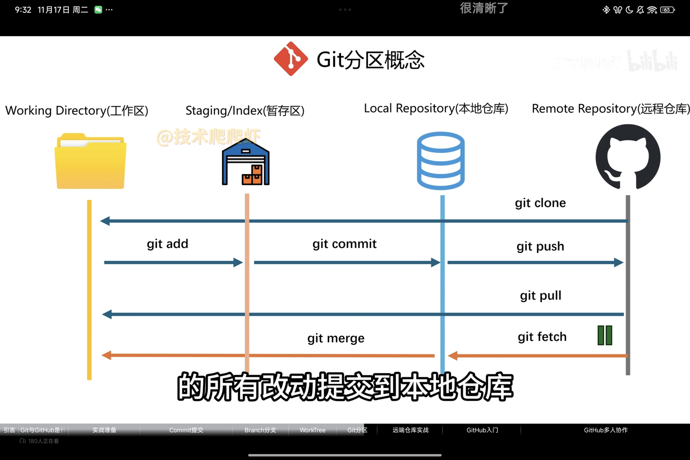

## GitHub

好用快捷键：

1. `/` 打开 github 的搜索栏
2. `t` 快速定位文件搜索栏
3. `l` 快速定位行号
4. `?` 查询快捷键表

### GitHub 多人协作

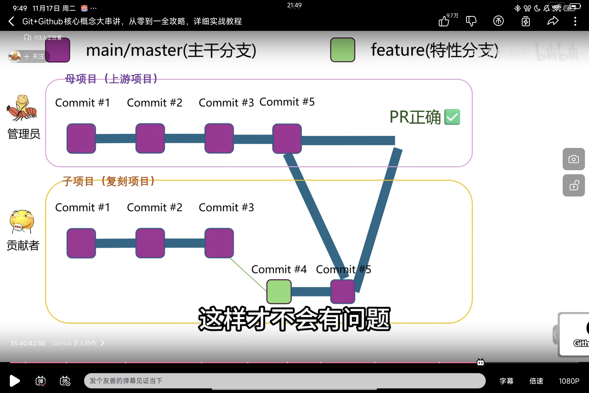

# 总结

1. Git 是一个分布式版本控制系统，类似游戏存档功能，可以控制存档、读档。记录文件的每一次改动，随时回退历史、并行开发、合并不同人的工作。

git 极高的自由度、安全性，分布式胖揍依赖于一个服务器的集中式。

2. 为什么开发者需要版本控制？

- 版本控制可以随时存档又精准回退。可以让开发者写代码更大胆。有点像玩游戏开赌前存档，不满意结果就读档。
- 而且可以知道我们每一次提交时修改了什么，让工作内容更加清晰、更加一目了然。
- 方便我们各自完成各自的工作，创建分支工作，互不干扰领地~~~
- 可以方便我们追溯工作中的问题，定位我们经常犯的错误。

直接复制文件备份有什么局限？

- 完整拷贝文件，会很占用内存，复制过程当中也有一定风险；
- 备份记录没有版本控制那样那么完整，不能显示何人何时修改了什么，修改了文件，可能在时间久了之后就看不懂代码了。
- 多人协作通过 QQ 等传递文件时候面临着麻烦，系统不兼容的风险。备份之后回退复制整个文件，回退风险太大了；
- 不知道"改了什么"：两个文件夹摆在一起，只能看到结果不同，看不到具体哪几行变了、为什么变。排 bug 时无法回答"这个错误是哪次改动引入的"。

3. Git 是工具，GitHub 和 Gitee 是托管 Git 仓库的云端平台。GitHub 国外访问慢但生态大、Gitee 国内快且中文界面。

4. 什么是仓库、提交、分支和合并？

- 仓库（Repository / repo）：一个项目的完整"档案室"，包含所有文件、历史记录和元数据（本地的 .git 隐藏目录）。分本地仓库和远程仓库。
- 提交（Commit）：对文件改动拍下的一张"快照"，包含作者、时间、说明和一个唯一编号（哈希值）。流程是 git add（暂存）→ git commit（提交）。
- 分支（Branch）：从某个提交点分出来的独立开发线，像平行宇宙。默认分支通常是 main/master。可以在 feature/login 分支上开发新功能，不干扰别人。
- 合并（Merge）：把一条分支的改动整合进另一条分支。GitHub/Gitee 上通过 Pull Request（PR）完成，合并时若两边改了同一处，会产生冲突，需人工解决后再提交。

5. 团队协作中如何用 Git 管理和同步项目文件？

- 克隆仓库：负责人创建远程仓库，每人 git clone 到本地。
- 建分支开发：不要直接在 main 上改。每个人按任务建分支，如 git checkout -b feature/xxx。
- 小步提交：改完一部分就 git add + git commit，提交信息写清楚做了什么。
- 保持同步：干活前后常执行 git pull（拉取远程最新代码），避免本地落后太多。
- 推送分支：git push origin feature/xxx 把本地分支推到远程。
- 发起 Pull Request：在平台上申请把自己的分支合并到 main → 团队 Code Review（代码评审）→ 通过后合并。
- 处理冲突：若 PR 提示冲突，本地 git pull 后手动编辑冲突文件（删除 `<<<<<<<`、`=======`、`>>>>>>>` 标记并保留正确内容），再 add + commit + push。

# 一些指令

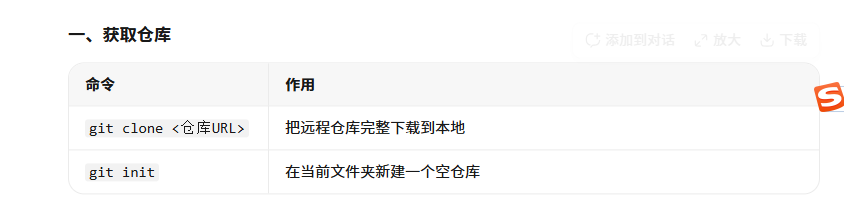

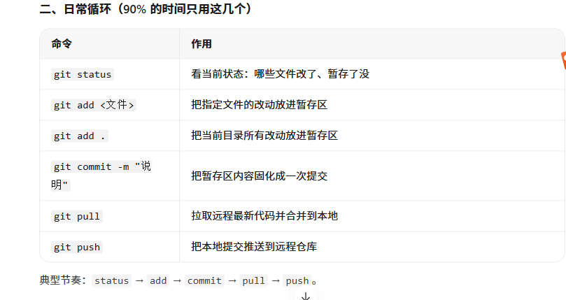

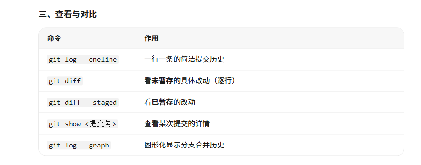

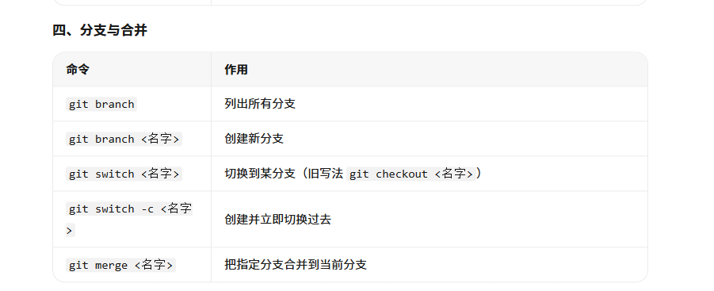

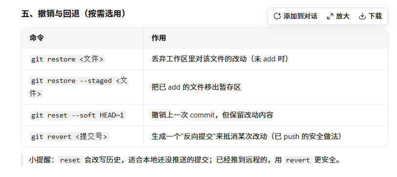

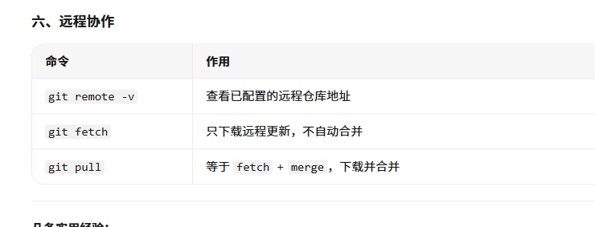

# 任务完成中的记录

1. 写笔记忘记保存了，重写。哦不。
2. vsc 打开终端快捷键 Ctrl+`（或者查看 → 终端）。

推送指定的 commit：`git push origin <commit 的哈希>:main`

3. 尝试在 gitee 克隆了一个仓库：首先打开 vsc，Ctrl+Shift+p，打开 gitee 上仓库克隆，复制代码链接，粘贴在 vsc 上的搜索栏里面，回车~~~克隆成功（记得切换分支哟）。

4. 还是学会自己手动建仓库之类的，用 ai 感觉速度不是很快。

5. 从 0 开始的 git：

- 先打开 git，输入以下命令：`cd ~/(文件夹地址)`；此命令是用来进入文件夹的。

  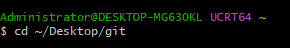

- `git init` 把当前目录初始化成一个 Git 仓库

  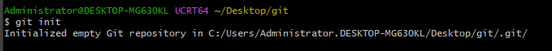

- `git status` 查看当前状态

  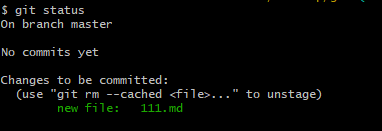

- `git add 文件名` 存文件在暂存区

  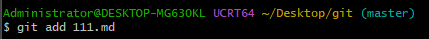

- 设置名字邮箱
- `git commit -m`（-m 是你修改的说明）

  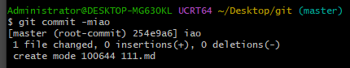

创建分支：

- `git branch 分支名称`，可直接输入 `git branch` 查看所有分支

  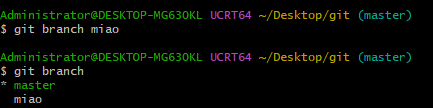

- 切换分支 `git switch 分支名称`

  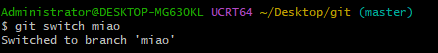

- `git switch -c 分支名称`（先创建分支并切换过去）

  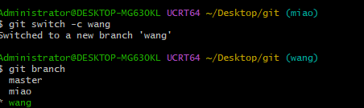

合并分支（把别的分支合并到自己的分支上，先切换到主分支上）：

- `git merge`

  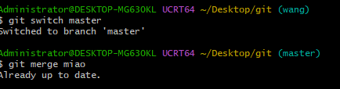

- `git branch -d` 删除分支

  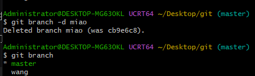

冲突处理：

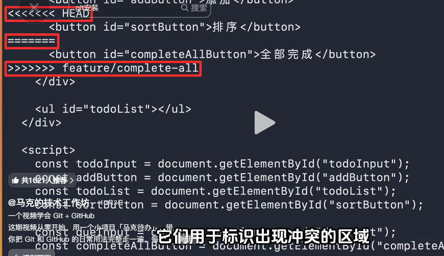

- 冲突处理完记得提交。

推送：

- `git remote add origin git@github.com:...`
- `git push -u origin master`
